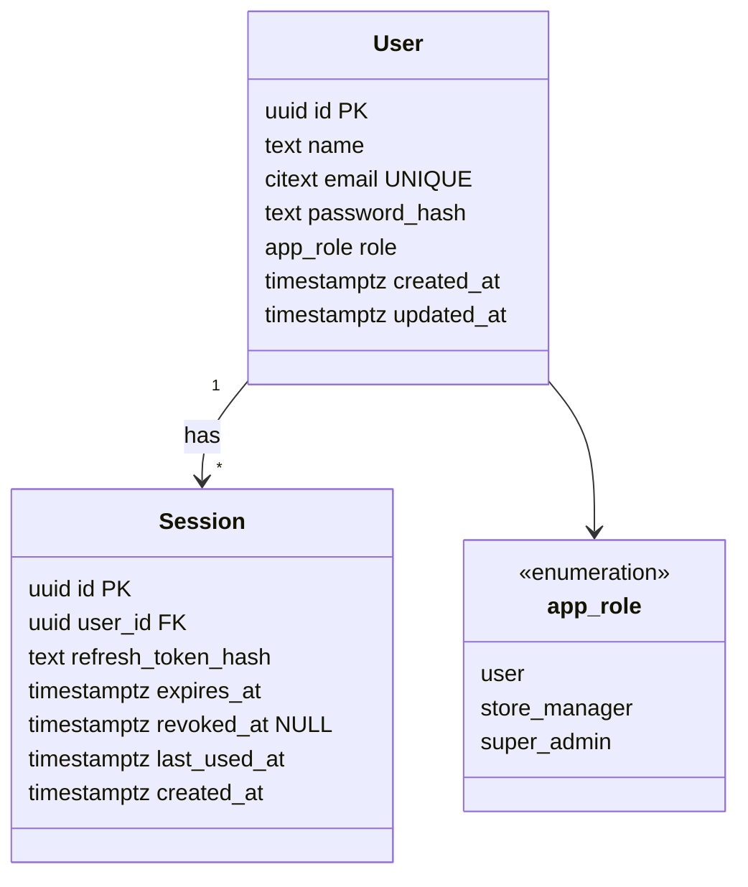
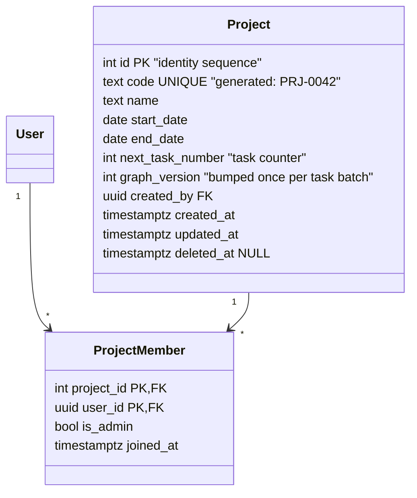
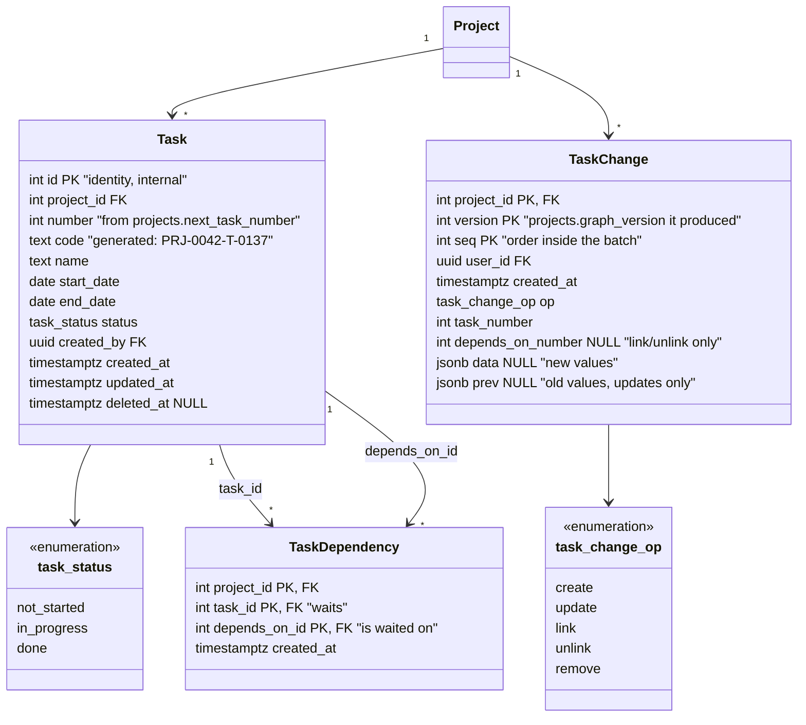
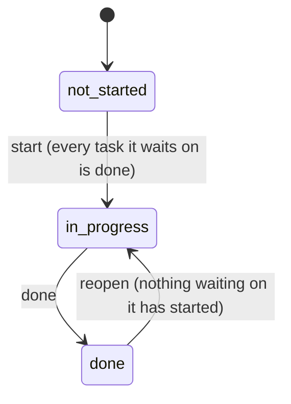
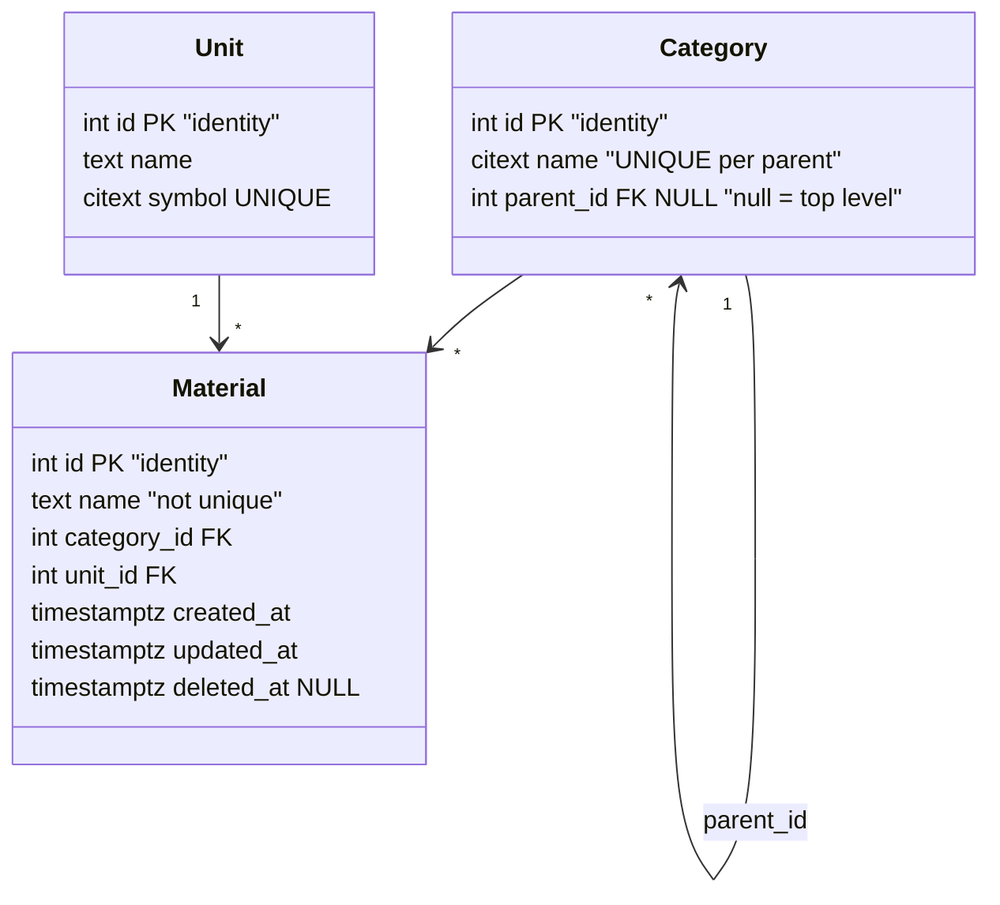

i will be using this readme to explain some of my thought process and assumptions. organized chronologically. my apologize if its not perfectly structured. also iam assuming Ai assistance would be fine 

----------
# initial read
  - there seem to be enough moving part but the core part to focus on initally would certainly be user auth and security and activity logs. but the registration process does not make sense to me cause i initially assumed this is aimed for 1 company as an internal tool. as thus user creation and permissions would be set by an admin (or it could also connect to some HR software API)
    1- do two super admins see each other projects ? or are they meant as different companies ?
    2- can anyone just "register" the account as super admin and see everything the company is working on ?
  both of these questions rely on the concept of "company" here. theres also some legal considerations if its multi company in one database ect. more importantly it may affect some tech choices if its multi tenant or not. eg drrizle ORM vs supabase since supabase gives a good base to have SSO/auth and other typical needs for scale. but i may be hesitant about it cause supabase is quite bulky and may not fit the context of "small server"
  this bring up that i will not consider a bare postgress DB. using an ORM would make any future schema changes easier to migrate and handle. i also wouldnt consider DB services (prisma/planetscale) since we are running this in a self hosted env
  
  - i just noticed it was stated "Build it for a large company that has used SiteTrack for years." so the only concern still open is user registration process. letting the user choose his permissions is a security risk  
  - should i assume that all users will have the same company email and set a guardrail for it ? 
  - the built in  alternative for registration is sending invite to the system through a tokenized URL by email by someone with proper clearance for that. (eg this what the ERP odoo  does). but this feels out of scope
  other vague notes i reemember
  - units of measure will have to be considered how is it getting handled. eg 50 kg bags but some tasks may reqruire 3.5 bags. also delevries may be counted in tonnes or lots. also depending how deep the integration would be i also wouldnt mix materials coming from different sources or at least follow exact inventory movement transaction. in case of call back and returns back from suppliers 
  
  after these initial questions i will stick to typescript with drizzle ORM (personal preference for smaller footprint prisma might be better in some cases). out of familiarity along with nestJS for routes/controllers this usally also gives best dev experience with frontend. i will also be using a monolith architecture to simplify deployement and structure with one DB. micro services wouldnt change performance IMO.  and this should be the step where i make the specefic models and important notes
  - typical jwt setup with refresh token on db that can be revoked
  - some may suggest redis/keyval or similair cache here but i dont think it would make a difference in our stress test size. its also easy enough to add later if we judge it would make a diff 
- another note typical registration require to mention that an email is already used and cant be reused. i dont know a way to not reveal that and not confuse the user if they are doing it by mistake
  - iam not adding routes that werent requests. eg in this case delete users.
  
  - for docker i will use node:alpine. since its usually the smallest and secure. there may be some docker networking setting to change/set for security

# user table assumptions
  - initially im not setting any CORS/CSRF and assuming everything is in this project under same url
  - having postgress handle the auth probably means i should purge the history of sessions at some point
  - i usually would rely on cloudflare or similair reverse proxy to stop brutefrocing/DDOS ect but thats devops in my case i will simply use nestjs throttle for simple application level throttling but it has its limits alone and would require some other setup alongside it for proper security. 
  - for the roles im sticking to a simple enum. in this type of app where permissions may differ in the future we may want them to be user editable and thus runtime editable. it adds a few tables and a lot of niche scenarios to handle 

in this step i realized i have not been writing tests and did not explain that part of choosing nestJS was that too(along with keeping swagger docs in sync). so i will do it along creating the tables
# project table assumptions
  - superadmins get full rights on every project as if they were a project admin (edit, delete, manage members), not just read access. a non member project admin action from a regular member returns 403 since they already know the project exists, a non member always gets 404
  - unique sequential codes: the project id is a postgres identity column (a sequence). `nextval` is atomic and lives outside transactions, so two inserts at the same moment can never get the same number, and a number is never handed out twice even after a rollback or a delete. the `PRJ-0042` code is a generated column computed by postgres from that id (padded to 4 digits, keeps growing past `PRJ-9999`) with a unique constraint as a safety net. the trade off is that a failed insert leaves a gap in the numbering, which the brief allows since it only asks for unique, counting up and never reused
  - pagination: lists can get big (a superadmin sees all 2000 projects, a project has up to 3000 tasks, deliveries have millions of lines), returning everything would blow up response size and memory on a small server. lists take `?limit` (default 50, max 200) and `?offset` and return `{ items, total, limit, offset }`, the total comes from a `count(*) over ()` window in the same query so it costs no extra round trip. offset gets slower on very deep pages and rows can shift if something is inserted while paging, keyset/cursor pagination would fix both but isnt worth it at this size
  - deleting a project is implemented as a soft delete since the brief asks for remove, but in a real construction company i dont think deleting should be the normal action. a project carries history (tasks, deliveries, stock that physically sits on site) and losing access to it breaks reporting and inventory tracking. archiving (read only, hidden from default lists, restorable) would be the better default and deleting would be reserved for mistakes. not implemented here
  - for admin roles iam adding a demote to member action. with some simple logic that older admins can revoke newer ones. if i want to make it changable i would make a hiarchy list were the ones above can changes the one under and themselves.
# notifications table
  - in this asignment it might be simpler to have notification only handle invitations. eg only a table of invitation of user X project. but in a real scenario we probably would want it to handle more then that (messages/tags, projects milestone updates,emails/push notifciations or other websocket expansions ect), and this probably open a can of worms of complex logic (message broker like rabbitMQ and redis for cache ect) just to keep my sanity and deliver this project i will only handle invitations in the simplest case a table index by users organized by time(aka in my case notification=invitation which usually isnt the case), and frontend would just poll the endpoint (no websocket). in a real scenario i would porbably search for a package or service maybe.
# tasks 
  - well this might be the most complex part that may require a bit more drilling. especially in the case of syncing changes and conflicts (two people changing same/related things around the same  moment.) judging by the UI i dont think we will need a "live editing" feature using websockets. theres the case of batch edit which could cause odd issues (person A try to batch change multiple tasks to done but one of these tasks becomes invalid cause B added a new depedency). as a backend engineer i will just mmake the API flexible enough and give the necessary tools to handle this type of errors. in this case the key things are
  -- SSE to make frontend refresh data. "task version" that can used to compare different state changes and get from (eg user still in version 1 but latests is version 3). 
  -- a way to keep track of graph versions to handle batch changes merge conflicts. theres probably fancy complex solution maybe  using hashes like some type of merkel tree but i will simply use the mentioned "task version" to know what changed and what needs a check . and they are only refused if a change breaks the backend rule
  -- i could also keep a changelog table. which could be useful to return to previous versions. i think im gonna stick to this changelog table its just more robust for future needs. i will have to trim it tho after X amount of time.
  - other key things implemented here would be write lock per project when adding tasks this confirms no cycle are created and enforce the hisotry/versions
# delveries/store
  - well in short this is some sort of inventory management. usually i would rather have a more complex repesentation of material. one that handle differents units of measure (eg purchase in Tons but use in KG.) and maybe lots on receipts/ purchase orders. in my case i will simply handle this as invotyr movement with materials coming from a material catalogue. so it will be  easy to see all movmenet of material X that happened.  
----------
# Models

## User

| Method | Path | Auth | Purpose |
|---|---|---|---|
| POST | `/auth/register` | none | name, email, password, role → profile (409 if email taken) |
| POST | `/auth/login` | none | email, password → sets `access_token` + `refresh_token` httpOnly cookies |
| POST | `/auth/refresh` | refresh cookie | rotates both cookies; an old refresh token is rejected |
| POST | `/auth/logout` | refresh cookie | revokes current session, clears cookies |
| GET | `/me` | access cookie | own profile (never the hash) |

## Project

| Method | Path | Who |
|---|---|---|
| POST | `/projects` | any logged-in user; creator becomes project admin |
| GET | `/projects` | projects the caller can access |
| GET | `/projects/:code` | members, SuperAdmin |
| PATCH | `/projects/:code` | project admins, SuperAdmin |
| DELETE | `/projects/:code` | project admins, SuperAdmin (soft delete) |
| GET | `/projects/:code/members` | members, SuperAdmin |
| POST | `/projects/:code/members/:userId/admin` | project admins, SuperAdmin |
| DELETE | `/projects/:code/members/:userId` | project admins, SuperAdmin |

## Task

| Method | Path | Who |
|---|---|---|
| POST | `/projects/:code/tasks` | members, SuperAdmin |
| GET | `/projects/:code/tasks` | members, SuperAdmin (`status`, `late`, `blocked`, `from`, `to`, `q`, `sort`, `order`) |
| GET | `/projects/:code/tasks/:taskCode` | members, SuperAdmin |
| PATCH | `/projects/:code/tasks/:taskCode` | members, SuperAdmin |
| DELETE | `/projects/:code/tasks/:taskCode` | members, SuperAdmin (soft delete) |
| POST | `/projects/:code/tasks/:taskCode/start` | members, SuperAdmin |
| POST | `/projects/:code/tasks/:taskCode/done` | members, SuperAdmin |
| POST | `/projects/:code/tasks/:taskCode/reopen` | members, SuperAdmin |
| POST | `/projects/:code/tasks/:taskCode/dependencies` | members, SuperAdmin |
| DELETE | `/projects/:code/tasks/:taskCode/dependencies/:dependsOnCode` | members, SuperAdmin |
| GET | `/projects/:code/tasks/snapshot` | members, SuperAdmin (every task and link + `version`) |
| POST | `/projects/:code/tasks/changes` | members, SuperAdmin (batch, all or nothing, `?dryRun`) |
| GET | `/projects/:code/tasks/changes` | members, SuperAdmin (`?since=<version>`, 410 when trimmed) |

## Material catalogue

| Method | Path | Who |
|---|---|---|
| GET | `/units` | any logged-in user |
| POST | `/units` | store managers, SuperAdmin |
| PATCH | `/units/:id` | store managers, SuperAdmin |
| DELETE | `/units/:id` | store managers, SuperAdmin (409 while materials use it) |
| GET | `/categories` | any logged-in user (flat list, tree via `parentId`) |
| POST | `/categories` | store managers, SuperAdmin |
| PATCH | `/categories/:id` | store managers, SuperAdmin (rename/move, 409 if moved inside itself) |
| DELETE | `/categories/:id` | store managers, SuperAdmin (409 while it has subcategories or materials) |
| GET | `/materials` | any logged-in user (`q`, `category` incl. subcategories, `sort`, `order`) |
| GET | `/materials/:id` | any logged-in user |
| POST | `/materials` | store managers, SuperAdmin |
| PATCH | `/materials/:id` | store managers, SuperAdmin |
| DELETE | `/materials/:id` | store managers, SuperAdmin (soft delete) |
