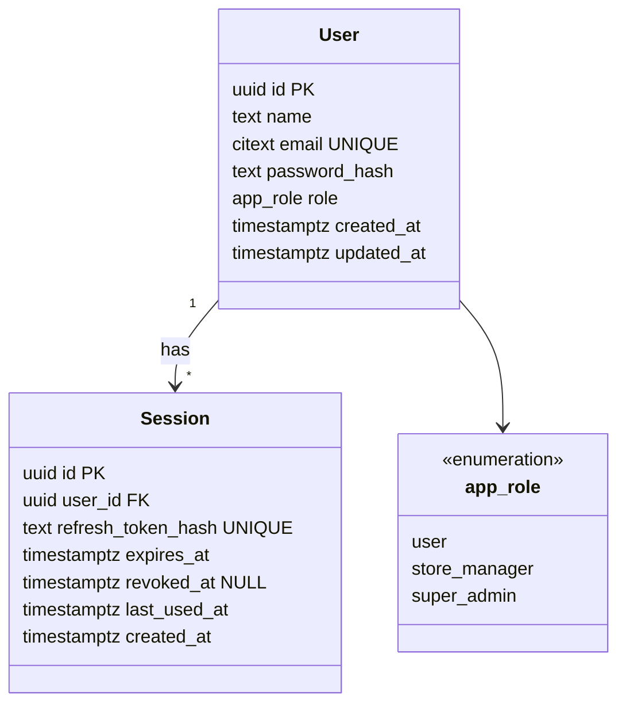

i will be using this readme to explain some of my thought process and assumptions. organized chronologically. my apologize if its not perfectly structured. also iam assuming Ai assistance would be fine 

----------
# initial read
  - there seem to be enough moving part but the core part to focus on initally would certainly be user auth and security and activity logs. but the registration process does not make sense to me cause i initially assumed this is aimed for 1 company as an internal tool. as thus user creation and permissions would be set by an admin (or it could also connect to some HR software API)
    1- do two super admins see each other projects ? or are they meant as different companies ?
    2- can anyone just "register" the account as super admin and see everything the company is working on ?
  both of these questions rely on the concept of "company" here. theres also some legal considerations if its multi company in one database ect. more importantly it may affect some tech choices if its multi tenant or not. eg drrizle ORM vs supabase since supabase gives a good base to have SSO/auth and other typical needs for scale. but i may be hesitant about it cause supabase is quite bulky and may not fit the context of "small server"
  this bring up that i will not consider a bare postgress DB. using an ORM would make any future schema changes easier to migrate and handle. i also wouldnt consider DB services (prisma/planetscale) since we are running this in a self hosted env
  
  - i just noticed it was stated "Build it for a large company that has used SiteTrack for years." so the only concern still open is user registration process. letting the user choose his permissions is a security risk  
  - should i assume that all users will have the same company email and set a guardrail for it ? 
  - the built in  alternative for registration is sending invite to the system through a tokenized URL by email by someone with proper clearance for that. (eg this what the ERP odoo  does). but this feels out of scope
  other vague notes i reemember
  - units of measure will have to be considered how is it getting handled. eg 50 kg bags but some tasks may reqruire 3.5 bags. also delevries may be counted in tonnes or lots. also depending how deep the integration would be i also wouldnt mix materials coming from different sources or at least follow exact inventory movement transaction. in case of call back and returns back from suppliers 
  
  after these initial questions i will stick to typescript with drizzle ORM (personal preference for smaller footprint prisma might be better in some cases). out of familiarity along with nestJS for routes this usally also gives best dev experience with frontend. i will also be using a monolith architecture to simplify deployement and structure with one DB. micro services wouldnt change performance IMO.  and this should be the step where i make the specefic models and important notes
  - typical jwt setup with refresh token on db that can be revoked
  - some may suggest redis/keyval or similair cache here but i dont think it would make a difference in our stress test size. its also easy enough to add later if we judge it would make a diff 
- another note typical registration require to mention that an email is already used and cant be reused. i dont know a way to not reveal that and not confuse the user if they are doing it by mistake
  - iam not adding routes that werent requests. eg in this case delete users.
  

----------
# Models

## User

| Method | Path | Auth | Purpose |
|---|---|---|---|
| POST | `/auth/register` | none | name, email, password, role → profile |
| POST | `/auth/login` | none | email, password → access + refresh token |
| POST | `/auth/refresh` | refresh token | rotate pair; reuse of an old token revokes the session |
| POST | `/auth/logout` | access token | revoke current session |
| GET | `/me` | access token | own profile (never the hash) |
